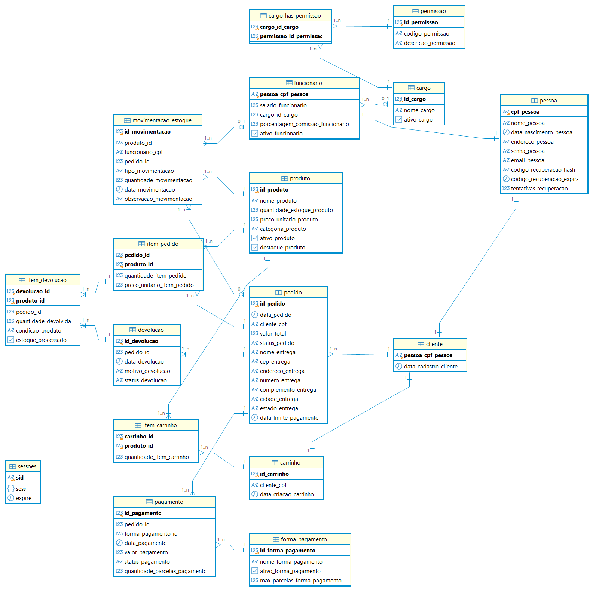

# Entre Laços 🧶

## 1. Sobre o projeto

Entre Laços é uma loja virtual de produtos de crochê desenvolvida como projeto escolar da disciplina de Desenvolvimento Web, do curso Técnico Integrado em Informática da UTFPR – Campus Campo Mourão.

O projeto tem como objetivo oferecer uma plataforma de comércio eletrônico para a exposição e venda de produtos artesanais, com uma interface organizada e agradável.

O sistema possui duas áreas principais: a visão do cliente e a visão do gerente.

## 2. Funcionalidades

### Visão do cliente
- Cadastro de clientes;
- Login e autenticação;
- Visualização e pesquisa de produtos;
- Carrinho de compras persistente;
- Finalização de pedidos;
- Pagamento simulado;
- Recuperação de senha por e-mail.
- Visualizar o seu histórico de pedidos e os dados da conta.

### Visão do gerente

- Gerenciamento de produtos;
- Gerenciamento de estoque;
- Gerenciamento de clientes;
- Gerenciamento de funcionários;
- Gerenciamento de cargos e permissões;
- Acompanhamento de pedidos;
- Controle de movimentações de estoque;
- Gerenciamento de devoluções.

## 3. Tecnologias e Dependências
### Tecnologias do projeto
- HTML
- CSS
- JavaScript
- Node.js
- Express
- PostgreSQL

### Dependências do projeto

As principais dependências utilizadas no backend são:

- **Express:** criação e gerenciamento do servidor web.
- **pg:** conexão e comunicação com o PostgreSQL.
- **bcrypt:** proteção de senhas por hash.
- **express-session:** gerenciamento de sessões.
- **connect-pg-simple:** armazenamento de sessões no PostgreSQL.
- **cors:** configuração de acesso entre origens.
- **dotenv:** leitura de variáveis de ambiente.
- **multer:** tratamento de arquivos enviados.
- **nodemailer:** envio de e-mails.

## Banco de Dados

O projeto Entre Laços utiliza o **PostgreSQL** para armazenar e organizar os dados da loja virtual.

O banco de dados possui tabelas relacionadas ao cadastro de pessoas, clientes e funcionários, ao gerenciamento de produtos e estoque, aos carrinhos de compras, aos pedidos, aos pagamentos e às devoluções.

### Diagrama do Banco de Dados

O diagrama apresenta as tabelas do banco de dados e seus relacionamentos.



### Principais tabelas

- **Pessoa:** armazena os dados pessoais e de acesso dos usuários.
- **Cliente:** registra os clientes cadastrados.
- **Funcionário:** armazena informações dos funcionários.
- **Cargo e Permissão:** organizam os cargos e as permissões de acesso ao sistema.
- **Produto:** contém os dados dos produtos disponíveis na loja.
- **Carrinho e Item_carrinho:** armazenam os produtos adicionados ao carrinho.
- **Pedido e Item_pedido:** registram os pedidos realizados e os produtos que fazem parte deles.
- **Forma_pagamento e Pagamento:** organizam as formas de pagamento e os pagamentos dos pedidos.
- **Movimentacao_estoque:** registra as movimentações de entrada, saída e outras alterações no estoque.
- **Devolucao e Item_devolucao:** armazenam informações sobre as devoluções.
- **Sessoes:** registra as sessões utilizadas pelo sistema.

### Relacionamentos

O banco de dados utiliza diferentes tipos de relacionamentos:

- **1:1 (um para um):** Pessoa e Cliente; Pessoa e Funcionário.
- **1:N (um para muitos):** Cliente e Pedido; Pedido e Pagamento.
- **N:N (muitos para muitos):** Cargo e Permissão, por meio da tabela `cargo_has_permissao`; Pedido e Produto, por meio da tabela `item_pedido`.

Esses relacionamentos permitem organizar os dados e manter a ligação entre as informações utilizadas pelas diferentes funcionalidades do sistema.

## 5. Estrutura do projeto

O projeto está organizado em diretórios que separam o backend, o frontend e a documentação.

```text
EntreLacos/
├── backend/
│   ├── controllers/
│   ├── middlewares/
│   ├── routes/
│   ├── database.js
│   ├── email.js
│   ├── gerarHashGerente.js
│   └── server.js
│   
│
├── documentacao/
│   └── scriptLojaCroche.sql
│
├── frontend/
│   ├── cadastro/
│   ├── esqueciSenha/
│   ├── login/
│   ├── visaoCliente/
│   └── visaoGerente/
│
├── imagens/
├── .gitignore
├── package.json
├── package-lock.json
└── README.md
```

### Descrição dos diretórios

- **backend:** contém os arquivos responsáveis pelo servidor, conexão com o banco de dados, envio de e-mails e organização das rotas e controladores.
- **documentacao:** contém o script SQL utilizado para criação e organização do banco de dados.
- **frontend:** reúne as páginas e funcionalidades da interface, separadas entre cadastro, login, recuperação de senha, visão do cliente e visão do gerente.
- **imagens:** armazena as imagens utilizadas no projeto.

## 6. Como executar o projeto

### Pré-requisitos

- Node.js instalado;
- PostgreSQL instalado e em funcionamento;
- Banco de dados do projeto criado;
- Arquivo `.env` configurado.

### Instalação e configuração

1. Clone ou copie o projeto para seu computador.
2. Crie o banco de dados PostgreSQL e execute o script SQL disponibilizado na pasta `documentacao`.
3. Configure as variáveis de ambiente necessárias no arquivo `.env`.
4. Abra o terminal na pasta principal do projeto e instale as dependências:

```bash
npm install
```

### Inicialização do servidor

1. Abra o terminal na pasta `backend`.
2. Execute o comando:

```bash
node server.js
```

3. Aguarde a mensagem de confirmação de que o servidor está executando na porta 3001 e que o banco de dados foi conectado.

O servidor estará disponível em:

```text
http://localhost:3001
```

3. Após a inicialização do servidor, acesse a aplicação pelo navegador, utilizando o endereço local configurado no projeto.

### Inicialização do frontend

1. Com o servidor backend em execução, abra a pasta `frontend` no VS Code.
2. Localize o arquivo HTML da página inicial da visão do cliente.
3. Clique com o botão direito sobre o arquivo.
4. Selecione a opção **Open with Live Server**.
5. A aplicação será aberta no navegador.

## 7. Segurança

O projeto possui autenticação de usuários e recuperação de senha por e-mail.

As informações de configuração, como credenciais de acesso ao banco de dados e dados utilizados para o envio de e-mails, são armazenadas em um arquivo `.env`, que não deve ser compartilhado ou enviado ao repositório.

## 8. Autoria

Projeto desenvolvido por Rebeca Prado da Silva, estudante do curso Técnico Integrado em Informática da UTFPR – Campus Campo Mourão, para a disciplina de Desenvolvimento Web.